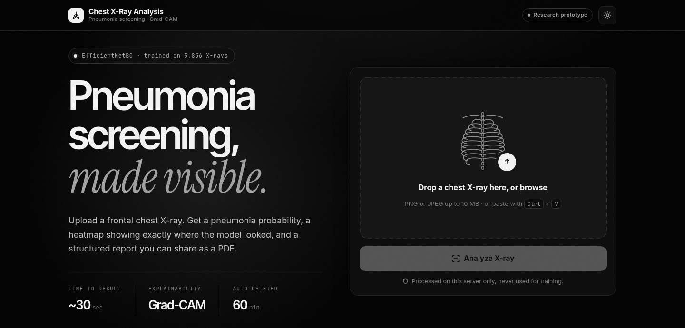

# Automated X-ray Image Analysis and Report Generation

A web app that screens chest X-rays for pneumonia with a deep learning classifier, shows **where** the model looked using Grad-CAM, and drafts a downloadable PDF report with the Gemini API.

> **Research prototype — not for clinical use.** Outputs must be reviewed by a qualified radiologist or physician.



## Features

- Pneumonia detection from chest X-ray images (EfficientNetB0 transfer learning).
- Grad-CAM heatmaps with an original / heatmap / blend viewer and a plain-language description of where the model focused.
- Live progress while the image is analysed; results get their own page you can revisit.
- Written report generated by Gemini (optional — the app works without an API key).
- PDF export with the finding, confidence, images and report.
- Privacy: uploads are deleted automatically (default 60 minutes) or on demand with **Delete my data**.
- Hardened for deployment: CSRF protection, upload rate limiting, file type/size validation, no debug mode by default.

## Dataset

[Labeled Chest X-Ray Images (Kaggle)](https://www.kaggle.com/datasets/tolgadincer/labeled-chest-xray-images) — 5,856 validated chest X-ray images labelled NORMAL / PNEUMONIA.

## Model performance

Run the evaluation script on the dataset's `test/` folder and record the numbers here:

```bash
python evaluate.py path/to/chest_xray/test
```

| Metric | Value |
| --- | --- |
| Accuracy | _run `evaluate.py`_ |
| Sensitivity (recall for pneumonia) | |
| Specificity | |
| Precision | |
| F1 | |
| ROC AUC | |

## How to run

### 1. Clone the repository and get the model

The trained model (`x-ray-classification.h5`, ~17 MB) is stored with [Git LFS](https://git-lfs.com/).

```bash
git lfs install            # once per machine (e.g. `sudo apt install git-lfs` first on Ubuntu)
git clone https://github.com/sujitwagh9/Pneumonia-Detection-and-Report-Generation.git
cd Pneumonia-Detection-and-Report-Generation
git lfs pull
```

If you cloned without Git LFS, the `.h5` file is a 133-byte text pointer and the app will tell you so. Either run `git lfs pull`, or [download the model from Google Drive](https://drive.google.com/file/d/1O7viAG4WQetngYA0x7edasiaOncK6HWz/view?usp=sharing) and save it as `x-ray-classification.h5` in the project root.

### 2. Create a virtual environment (Python 3.10–3.12)

```bash
python -m venv .venv
source .venv/bin/activate      # Linux / macOS
.venv\Scripts\activate         # Windows
```

### 3. Install the dependencies

```bash
pip install -r requirements.txt
```

### 4. Configure

```bash
cp .env.example .env
```

Then edit `.env`:

| Variable | Required | Description |
| --- | --- | --- |
| `GEMINI_API_KEY` | For the written report | Get one at [Google AI Studio](https://aistudio.google.com/apikey). Without it, classification, Grad-CAM and the PDF still work. |
| `SECRET_KEY` | In production | Random string for CSRF tokens: `python -c "import secrets; print(secrets.token_hex(32))"` |
| `GEMINI_MODEL` | No | Defaults to `gemini-3.5-flash`. Change it if Google retires that model. |
| `PREPROCESSING` | No | `auto` (default), `raw`, `rescale` or `mobilenet_v2`. Must match how the model was trained — see below. |
| `RETENTION_MINUTES` | No | How long uploads are kept (default `60`). |
| `UPLOAD_RATE_LIMIT` | No | Per-IP upload limit (default `10 per minute`). |
| `MODEL_PATH`, `UPLOAD_FOLDER` | No | Override file locations. |

### 5. Run

**Development**

```bash
python app.py
```

Open <http://127.0.0.1:5000>. Set `FLASK_DEBUG=1` in `.env` for auto-reload while developing. Never enable it on a server reachable by others: the debugger allows running arbitrary code.

**Production**

```bash
gunicorn --workers 1 --threads 8 --timeout 120 --bind 0.0.0.0:8000 app:app
```

Each worker loads its own copy of TensorFlow and the model, so add workers only if you have the memory. With several workers, set `SECRET_KEY` and point `RATELIMIT_STORAGE_URI` at Redis (e.g. `redis://localhost:6379`, plus `pip install redis`) so limits are shared. Put the app behind HTTPS (e.g. nginx or Caddy).

### 6. Run the tests

```bash
pip install -r requirements-dev.txt
pytest
```

The tests build a small stand-in Keras model, so they don't need the real model or a Gemini key.

## Checking the preprocessing setting

The classifier only gives correct predictions if images are scaled the same way as during training:

- The bundled model is a Keras **EfficientNetB0**, which starts with its own `Rescaling` and `Normalization` layers, so it expects raw 0–255 pixels. `PREPROCESSING=auto` (default) detects those layers and uses `raw`.
- If the training pipeline *also* divided by 255 (e.g. `ImageDataGenerator(rescale=1./255)`), set `PREPROCESSING=rescale`.
- A model without built-in scaling that was trained with `ImageDataGenerator(rescale=1./255)` → `rescale`; with `mobilenet_v2.preprocess_input` → `mobilenet_v2`.

If unsure, run `evaluate.py` with each setting and keep the one with higher accuracy.

## Troubleshooting

- **"is a Git LFS pointer, not the trained model"** — see step 1.
- **The model fails to load with a Keras error** — the `.h5` may have been saved with Keras 2 (TensorFlow ≤ 2.15). Run `pip install tf-keras` and add `TF_USE_LEGACY_KERAS=1` to `.env`.
- **"The written report could not be generated"** — check `GEMINI_API_KEY`, and that `GEMINI_MODEL` is still offered by the Gemini API. The server log shows the exact error.

## Project structure

```
app.py           Flask routes, background jobs, upload storage and cleanup
analysis.py      Model loading, preprocessing, prediction and Grad-CAM
report.py        Gemini report generation and PDF export
evaluate.py      Accuracy / sensitivity / specificity / AUC on a labelled folder
templates/       Upload, progress and result pages
static/style.css UI styles (light and dark mode)
tests/           pytest suite
```

## Tech stack

- **Backend:** Flask, Flask-WTF (CSRF), Flask-Limiter, gunicorn
- **Machine learning:** TensorFlow / Keras, EfficientNetB0, Grad-CAM
- **Report:** Google Gemini API (`google-genai`), fpdf2

## Future scope

- Expand the dataset for improved accuracy.
- Detect other chest conditions such as tuberculosis.
- Real-time deployment in healthcare facilities.
